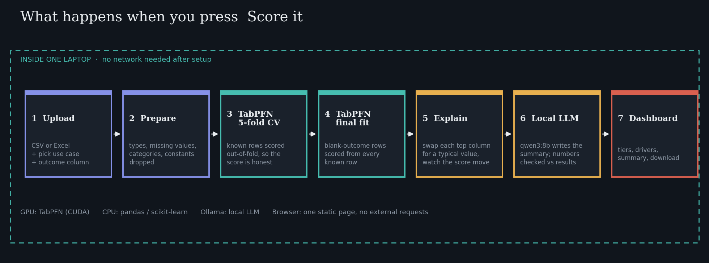
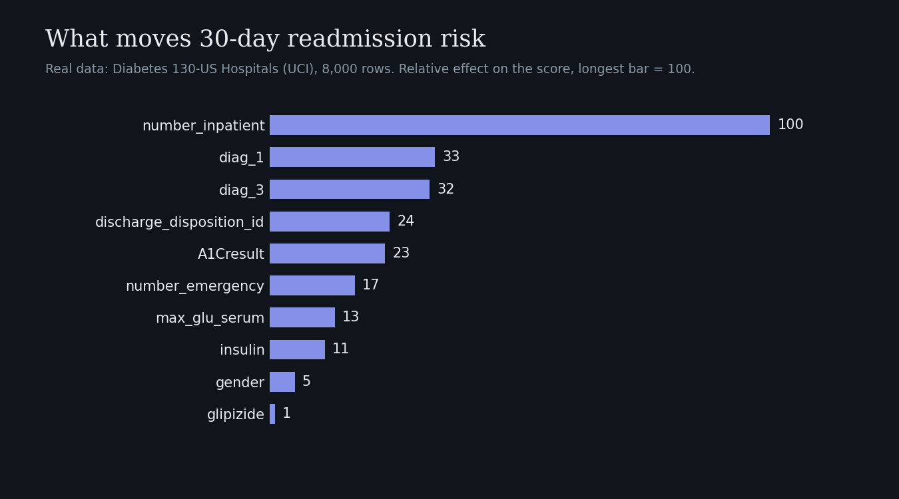

# Airgap

**Drop in a spreadsheet. Get risk scores. Nothing leaves this computer.**

Airgap is a local dashboard that scores a CSV or Excel file with [TabPFN](https://github.com/PriorLabs/TabPFN), Prior Labs' tabular foundation model, on your own GPU. There is no training run, no hyperparameter tuning and no cloud account. A local LLM (via Ollama) writes a one-page summary of the results.


> Built for the DEV **Hacktoberfest Open-Source AI Challenge, Week 2: Side Hustle**.
> Write-up: **[PASTE DEV POST LINK HERE]**

## Why

Small teams hold small, sensitive tables (hundreds to a few thousand rows) and are often not allowed to upload them to a cloud service. Airgap runs entirely on the machine that holds the data.

| Mode | Input | Output |
|---|---|---|
| **Clinical risk** | Patient records with lab markers | Risk score and tier per patient, top drivers per record, one-page clinical summary |
| **Industrial yield / failure** | Batch or machine telemetry | Expected yield with an **80% range** (flags batches outside it), or a machine-failure score |
| **Credit default** | Past loan outcomes | Default risk, approve / review / decline bands, cutoff slider, reason codes, approvals-vs-bad-loans chart |

**Scores are decision support only.** A clinician, engineer or credit officer stays responsible for every decision.

## How it works



1. **Upload** a CSV or Excel file, choose a use case and the outcome column.
2. **Prepare:** column types, missing values and categories are handled automatically. Constant columns are ignored and reported.
3. **TabPFN, 5-fold cross-validation** on rows with a known outcome (3-fold for very large files), so the accuracy shown is out-of-fold and honest.
4. **TabPFN, final fit** on all known rows to score rows whose outcome is blank.
5. **Explain:** for the 10 columns most related to the outcome, a typical value is swapped in and the score change is measured. Drivers are listed per record (up to about 150 records).
6. **Summarize:** a local LLM writes the summary from a small JSON of facts. Every number in its text is checked against the results. If it cites a number that is not in the facts, the text is rejected and a built-in template is used. The page states which one you got, and why if the LLM was not used.
7. **Dashboard:** tiers, drivers, summary, and a download of the scored sheet.

## Example result (real data)

*Diabetes 130-US Hospitals* (UCI), 8,000 rows and 47 columns, 30-day readmission. 7,800 rows with a known outcome, 200 scored as new.

| Metric | Value |
|---|---|
| Cross-validated AUC | **0.67** |
| Event rate | 12% |
| Top-decile lift | **2.4x** |
| Run time (laptop RTX 4090, 16 GB) | 269 s for the full pipeline |

An AUC around 0.67 is realistic for readmission, which is a noisy outcome. Results come from cross-validation on a public dataset, not from data from a different hospital, plant or lender, so a new site's numbers could differ.



## Quick start (Windows + NVIDIA GPU)

**Requirements:** Python 3.10 to 3.12 (tick "Add to PATH"), a current NVIDIA driver. **You do not need the CUDA Toolkit**; the PyTorch wheels bundle the CUDA runtime.

1. **Install (once, online):** double-click `install.bat`. It creates a virtual environment, installs the CUDA 12.8 build of PyTorch, installs the dependencies, then runs `check_gpu.py`.
2. **Accept the TabPFN licence and cache the weights (once):**
   - Open <https://ux.priorlabs.ai/account/licenses> and accept the licence.
   - Copy your API key from <https://ux.priorlabs.ai/account>.
   - Paste it into a file named `tabpfn_token.txt` in the project folder (key only, nothing else), or paste it when `check_gpu.py` asks.
   - `check_gpu.py` times a real TabPFN run on the GPU, then creates `.weights_ready`.
3. **Run:** double-click `run.bat` and open <http://127.0.0.1:8000>. With `.weights_ready` present, it starts in offline mode.
4. **Optional, local summaries:** install [Ollama](https://ollama.com) and pull a model, for example `ollama pull qwen3:8b`. `run.bat` sets `LLM_MODEL=qwen3:8b`; change it to any model you have pulled. Without Ollama, a built-in template writes the summary.

The top bar shows your GPU name and VRAM, or a red **CPU only**. If it says CPU only, see Troubleshooting.

### Real demo datasets

Run once while online to download and clean four public datasets (UCI, CC BY 4.0):

```bat
.venv\Scripts\activate
pip install xlrd
python prepare_datasets.py --rows 8000
```

Options: `--rows N` (max rows per file), `--only credit,clinical,ai4i,secom`, `--force` (re-clean from cached downloads). Each use case then shows extra **Real: ...** buttons.

| Use case | Dataset | Cleaning |
|---|---|---|
| Clinical | Diabetes 130-US Hospitals | Drops patients who died or went to hospice; outcome becomes "readmitted within 30 days" |
| Machine failure | AI4I 2020 (**synthetic**) | Drops the five failure-type columns that give away the answer |
| Semiconductor yield | SECOM | Merges labels; keeps the 100 best-filled sensors, chosen without looking at the outcome |
| Credit | Taiwan credit card defaults | Turns numeric codes for sex, education and marriage into labelled categories |

All four are shuffled, and the outcome is blanked on the last 150 to 300 rows so the "new rows" path is exercised. The built-in sample files are synthetic: metrics on them say nothing about real patients, plants or borrowers.

### Other platforms

`install.bat` and `run.bat` are Windows scripts, and Windows is the only platform I have tested. On Linux, the equivalent should be: create a venv, install a CUDA build of PyTorch, `pip install -r requirements.txt`, run `python check_gpu.py`, then `python server.py`.

## Input format

One row per record. One column holds the outcome: yes/no or 1/0 for classification, or a number for yield. Leave the outcome **blank** on new rows and they are scored from all known rows. If you do not name which value counts as the event, the rarer outcome is used.

## Configuration

Set these in `run.bat` (or your environment).

| Variable | Default | What it does |
|---|---|---|
| `LLM_MODEL` | `qwen3:8b` | Ollama model used for summaries (exact name must be installed) |
| `OLLAMA_URL` | `http://127.0.0.1:11434` | Where Ollama listens |
| `TABPFN_DEVICE` | auto | Force `cuda` or `cpu` |
| `TABPFN_MODEL_PATH` | auto | Use a local weights file |
| `TABPFN_N_ESTIMATORS` | auto | Fewer estimators run faster, at a small cost in accuracy |
| `MAX_TRAIN_ROWS` | `20000` | Cap on rows used as context |
| `TABPFN_TOKEN` | from `tabpfn_token.txt` | API key, needed only for the first weight download |
| `PORT` | `8000` | Server port |
| `ALLOW_FALLBACK` | `0` | `1` swaps in a scikit-learn model for UI development. A red banner shows while it is active. **Never use it for real results.** |

## Project layout

```text
airgap/
├── server.py            FastAPI app and job queue (one analysis at a time)
├── app/
│   ├── engine.py        TabPFN wrapper, CUDA detection, hardware info
│   ├── analysis.py      CSV -> features -> cross-validation -> final fit -> explanations
│   ├── narrative.py     local LLM summary with number guardrail and template fallback
│   └── samples.py       synthetic demo data
├── static/index.html    the whole UI: one file, loads nothing from the internet
├── prepare_datasets.py  downloads and cleans the real datasets
├── check_gpu.py         times a real TabPFN run on the GPU and caches the weights
├── install.bat          Windows installer
└── run.bat              starts the server
```

## Troubleshooting

- **Top bar says "CPU only".** Check which PyTorch build is installed:
  ```bat
  .venv\Scripts\activate
  python -c "import torch;print(torch.__version__, torch.version.cuda, torch.cuda.is_available())"
  ```
  If it prints a `+cpu` build, reinstall the CUDA build:
  ```bat
  pip uninstall -y torch torchvision torchaudio
  pip install torch --index-url https://download.pytorch.org/whl/cu128 --force-reinstall --no-cache-dir
  ```
  Plain `pip install torch` on Windows gives the CPU-only build, and pip may treat an existing CPU build as "already satisfied". If it still says `False`, update the NVIDIA driver.
- **TabPFN's browser login crashes in a `.bat` file.** The scripts set `TABPFN_NO_BROWSER=1` and read your key from `tabpfn_token.txt` instead.
- **Summary says "built-in template (LLM not used: ...)".** The text after the colon gives the reason: Ollama not reachable, model not installed, or the number guardrail rejected the model's text.
- **A run is slow.** Cost grows faster than linearly with row count. Try fewer rows (`prepare_datasets.py --rows 3000`) or set `TABPFN_N_ESTIMATORS=4`.

## Limitations

- TabPFN is slower per run than gradient-boosting models. Its value here is strong accuracy with no tuning, not speed.
- Results come from cross-validation on public datasets. External validation on data from another site has not been done.
- Drivers show influence on the score, not causation.
- Not a medical device, a safety certification or a credit decision system.

## Licences and credits

- **TabPFN model weights** are provided by [Prior Labs](https://priorlabs.ai) under their own licence. The free licence is **non-commercial**, so commercial use requires a commercial licence from Prior Labs. Check their current terms before any commercial use.
- **Datasets** come from the [UCI Machine Learning Repository](https://archive.ics.uci.edu) (CC BY 4.0): Diabetes 130-US Hospitals, AI4I 2020, SECOM, and Default of Credit Card Clients.
- **Summary model:** any open-weight model you run through [Ollama](https://ollama.com). Check the licence of the model you choose.
- **Code:** <!-- add a LICENSE file (for example MIT) and name it here -->
